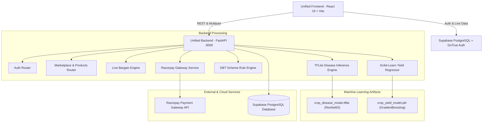

# KisaanSathi (Kisan Sathi) — Engineering Handoff Document

**Document Version:** 1.0  
**Date:** October 2026  
**Authors / Core Team:** Abedan Biswal, Faaeq Sayed, Uday Mahajan, Hakim Sheikh  
**Repository Root:** `c:/Users/abbsw/.gemini/antigravity/scratch/KisaanSathi`  
**Primary Workspaces:**  
- Unified Backend: `unified-backend/`  
- Unified Frontend: `unified-frontend/`  

---

## 1. Executive Summary & Project Purpose

**KisaanSathi** is an integrated, full-stack AI-powered agricultural ecosystem designed to empower Indian smallholder and commercial farmers. Agriculture engages over 240 million Indian citizens and contributes ~18% of the GDP, yet farmers face steep challenges:
- Undiagnosed crop diseases and delayed pest identification
- Difficulty estimating seasonal crop yields with fluctuating weather and nutrient levels
- Lack of awareness and complex eligibility criteria for Direct Benefit Transfer (DBT) government schemes (an estimated 18–67% of eligible farmers miss out)
- Middlemen-dominated supply chains where certified seeds, fertilizers, and equipment are sold at marked-up prices without price transparency

### Core Solution Modules
1. **AgriMart Marketplace**: Direct B2B/B2C marketplace connecting farmers to licensed APMC/CIB dealers, featuring real-time price bargaining/counter-offers, cart management, and Razorpay sandbox payments.
2. **AI Crop Disease Detection**: Deep-learning image inference (ResNet50 TFLite) classifying leaf diseases across 11 crop-disease categories (Corn, Potato, Tomato) with client-side image compression and actionable treatment advice.
3. **ML Crop Yield Prediction**: Gradient Boosting regression model estimating yield in Quintals per Acre based on soil nutrients (N, P, K), rainfall, temperature, and fertilizer metrics.
4. **DBT Government Schemes Advisory**: Automated eligibility rule engine mapping farmer land size, income, crop season, and state/district to central and state welfare programs with multilingual summaries (English, Hindi, Marathi).
5. **Unified Role-Based Auth**: Built on Supabase Auth with custom profiles supporting three distinct roles: `farmer`, `seller`, and `admin`.

---

## 2. System Architecture & Component Diagram

### Architectural Overview



### Transition from Microservices to Unified Monorepo
Originally, the project was developed as distinct sub-services:
- `backend/backend-marketplace/`, `backend/backend-schemes/`, `backend/backend-cropyield/`, `backend/backend-crop-disease/`, `backend/backend-loginsystem/`
- `frontend/frontend-marketplace/`, `frontend/frontend-schemes/`, `frontend/frontendtest-crop-disease/`, `frontend/frontend-loginsystem/`

To prevent cross-port conflicts, inconsistent authentication states, and duplicate dependencies, these have been consolidated into:
- **`unified-backend/`**: A single FastAPI service exposing all API routes under `/api/*` on port `8000`.
- **`unified-frontend/`**: A unified React 19 Single Page Application running under Vite on port `5173`.

The original service directories remain intact for reference and isolated testing if needed.

---

## 3. Technology Stack Reference

| Layer | Technologies / Libraries | Purpose |
|---|---|---|
| **Frontend Framework** | React 19 (`react`, `react-dom`), Vite 8 | High-performance modern web application |
| **Routing & Navigation** | `react-router-dom` v6 | Client-side routing with lazy-loaded page modules |
| **Styling & Icons** | Tailwind CSS 3.4, PostCSS, Lucide React, React Icons | Clean, responsive UI with mobile-first grid |
| **State & Auth Context** | `AuthContext`, `CartContext`, `FarmerContext`, `LanguageContext` | Global application state management |
| **Client Utilities** | `browser-image-compression`, `axios`, `react-hot-toast` | Client-side image optimization, toast alerts, API calls |
| **Backend Framework** | FastAPI 0.110+, Uvicorn (standard) | High-concurrency async REST API |
| **Data Validation** | Pydantic v2 (`pydantic-settings`) | Request/response schema contracts and environment parsing |
| **Database & Auth** | Supabase PostgreSQL, Supabase Python SDK v2.3+, PostgREST | Relational data persistence, Row Level Security (RLS) |
| **Deep Learning** | TensorFlow 2.15+ / TFLite Runtime, Pillow, NumPy | Lightweight image preprocessing and leaf disease classification |
| **Machine Learning** | Scikit-Learn 1.4+, Joblib, Pandas | Crop yield regression modeling |
| **Payment Gateway** | Razorpay Python SDK, HMAC-SHA256 signature verification | Test-mode order creation and checkout confirmation |

---

## 4. Repository Directory Structure

```
KisaanSathi/
├── KisaanSathi-SRS-Document.md   # Official IEEE/Wiegers SRS Document
├── README.md                     # Marketplace & Razorpay configuration readme
├── HANDOFF.md                    # This engineering handoff document
├── supabase_schema.sql           # Database schema: profiles, triggers, RLS policies
├── disease_schema.sql            # Disease definitions, symptoms, chemical/organic cures
├── test_api.json                 # API validation and test payload templates
├── merge_backend.py              # Script that consolidated backend microservices
├── merge_frontend.py             # Script that consolidated frontend microservices
│
├── database/                     # Database migrations & seeds
│   ├── migrations/
│   │   ├── 001_initial_schema.sql
│   │   ├── 002_scheme_rules_and_fields.sql
│   │   ├── 004_scraping.sql
│   │   └── 005_auth_profiles.sql
│   └── seed.sql
│
├── unified-backend/              # PRODUCTION BACKEND SERVICE
│   ├── .env                      # Backend environment variables
│   ├── requirements.txt          # Python dependencies
│   ├── start_backend.bat         # Windows one-click startup script
│   ├── train_yield_model.py      # Standalone training script for yield regression model
│   ├── seed_api.py               # Seed script creating test sellers, products & categories
│   ├── create_real_demo_users.py # Provisioning demo accounts (farmer, seller, admin)
│   ├── test_disease_api.py       # Automated smoke test for crop disease prediction
│   ├── inspect_tflite.py         # Utility to inspect TFLite input/output tensor shapes
│   ├── app/
│   │   ├── main.py               # FastAPI entrypoint, lifespan events, CORS, exception handlers
│   │   ├── config.py             # Pydantic BaseSettings loading .env
│   │   ├── database.py           # Supabase client instantiation
│   │   ├── dependencies.py       # Auth guards, JWT validation, current_user injection
│   │   ├── models/               # Pydantic schema validation definitions
│   │   │   ├── product.py
│   │   │   ├── bargain.py
│   │   │   ├── cart.py
│   │   │   ├── order.py
│   │   │   ├── payment.py
│   │   │   ├── category.py
│   │   │   └── market_price.py
│   │   ├── routers/              # API Route Controllers
│   │   │   ├── auth.py           # Login, signup, get profile
│   │   │   ├── products.py       # Catalog, filtering, seller product management
│   │   │   ├── categories.py     # Product category lists
│   │   │   ├── cart.py           # Shopping cart operations
│   │   │   ├── orders.py         # Order lifecycle, status updates
│   │   │   ├── bargain.py        # Real-time farmer-dealer price bargaining
│   │   │   ├── payments.py       # Razorpay order generation & HMAC verification
│   │   │   ├── sellers.py        # Verified seller directory & catalog views
│   │   │   ├── schemes.py        # Government DBT schemes & rule evaluation
│   │   │   ├── crop_yield.py     # Crop yield ML prediction
│   │   │   ├── ml_disease.py     # Crop disease image inference
│   │   │   └── market_prices.py  # Mandi price feeds & comparisons
│   │   └── services/             # Business logic & external service adapters
│   │       ├── crop_yield_predictor.py
│   │       ├── ml_service.py     # TFLite ResNet50 inference runner
│   │       ├── razorpay_service.py
│   │       ├── rule_engine.py    # Scheme qualification algorithms
│   │       ├── supabase_service.py
│   │       └── market_price_service.py
│   └── models/                   # Serialized ML model binaries
│       ├── crop_yield_model.pkl
│       └── crop-diseasemodel/
│           ├── crop_disease_model.tflite
│           └── class-names.json
│
└── unified-frontend/             # PRODUCTION FRONTEND APPLICATION
    ├── .env                      # Frontend environment variables
    ├── package.json              # NPM package manifest
    ├── vite.config.js            # Vite configuration
    ├── tailwind.config.js        # Tailwind theme, colors & font family definitions
    ├── public/                   # Static assets (logo, icons, images)
    └── src/
        ├── App.jsx               # Root router, Layout wrapper, Context Providers
        ├── main.jsx              # React DOM render entrypoint
        ├── index.css             # Tailwind base & custom utility styles
        ├── translations.js       # Multilingual dictionaries (EN, HI, MR)
        ├── api/
        │   └── client.js         # Base axios / fetch configuration
        ├── context/
        │   ├── AuthContext.jsx   # Supabase user session & profile state
        │   ├── CartContext.jsx   # Shopping cart state & backend sync
        │   ├── FarmerContext.tsx # Farmer details & farm parameters state
        │   └── LanguageContext.tsx # Language selector & active locale
        ├── services/
        │   └── api.js            # API client methods for yield & disease
        ├── lib/
        │   └── supabase.js       # Client-side Supabase JS client
        └── pages/                # Page views
            ├── LandingPage.jsx   # Modern landing page with feature cards
            ├── Home.jsx          # Marketplace homepage with banner & categories
            ├── Login.jsx         # Sign in with email/password & role redirect
            ├── Signup.jsx        # Farmer & Seller registration
            ├── RoleSelect.jsx    # Post-login role confirmation modal
            ├── FarmerPortal.jsx  # Farmer personal dashboard & active applications
            ├── ProductCatalog.jsx# Searchable catalog with filters
            ├── ProductDetail.jsx # Product view with Add-to-Cart & Bargain trigger
            ├── Cart.jsx          # Cart view with item count and subtotal
            ├── Checkout.jsx      # Address input & Razorpay checkout integration
            ├── OrderHistory.jsx  # Order tracking and invoice status
            ├── OrderSuccess.jsx  # Payment confirmation screen
            ├── BargainList.jsx   # Farmer active negotiation sessions
            ├── BargainDetail.jsx # Interactive price negotiation chat
            ├── DiseaseDetection.jsx # Image upload, compression & diagnosis view
            ├── CropYield.jsx     # Soil & weather yield prediction form
            ├── SchemesPage.tsx   # DBT schemes listing and filtering
            ├── SchemeDetailPage.tsx # Scheme eligibility criteria & application info
            ├── ApplicationFormPage.tsx # Scheme application form
            ├── ApplicationReviewPage.tsx # Review & submission
            └── seller/           # Seller Portal Pages
                ├── SellerDashboard.jsx # Sales analytics & pending tasks
                ├── SellerProducts.jsx  # Inventory management & stock updates
                ├── SellerOrders.jsx    # Order fulfillment & status updates
                └── SellerBargains.jsx  # Inbound price offers from farmers
```

---

## 5. Core Modules & Business Logic Walkthrough

### 5.1 Authentication & Role-Based Access Control (RBAC)
- **Database Model**: Supabase `auth.users` is mirrored into `public.profiles` with a PostgreSQL trigger (`handle_new_user`).
- **User Roles**:
  - `farmer`: Accesses Marketplace (buyer), Bargaining (buyer), Crop Disease Detection, Crop Yield Prediction, and DBT Schemes.
  - `seller`: Accesses Seller Dashboard, Product Listing, Stock Management, Order Fulfillment, and Farmer Bargain Negotiations.
  - `admin`: Verifies seller credentials, modifies scheme rules, and manages system settings.
- **Demo Accounts for Immediate Testing**:
  | Role | Email | Password |
  |---|---|---|
  | **Farmer** | `demo.farmer@kisaansathi.org` | `DemoFarmer@2025` |
  | **Seller** | `demo.seller@kisaansathi.org` | `DemoSeller@2025` |
  | **Admin** | `demo.admin@kisaansathi.org` | `DemoAdmin@2025` |

### 5.2 AgriMart Marketplace & Direct Price Bargaining
- **Catalog & Inventory**: Products support categories (Seeds, Fertilizers, Pesticides, Equipment), certified APMC dealer tags, base price, and stock levels.
- **Price Bargaining Engine (`/api/bargain/*`)**:
  1. A farmer clicks "Bargain Price" on a product card, providing a proposed quantity and target unit price.
  2. A `bargain_session` is created.
  3. The dealer sees the offer in `SellerBargains.jsx` and can:
     - **Accept**: Locks in the bargained unit price. The farmer can directly add the negotiated price into their cart.
     - **Counter-offer**: Submits a counter unit price with notes.
     - **Reject**: Closes the bargaining session.
  4. Once accepted, adding to cart preserves the `bargain_session_id` so the discounted rate applies at checkout.

### 5.3 Razorpay Payment Integration (Test Mode Sandbox)
- **Checkout Flow**:
  1. Frontend submits cart items to `POST /api/payments/create-order`.
  2. Backend verifies current prices (and any approved bargain discounts), generates an internal order record (`payment_status='pending'`), and calls the Razorpay API to generate a `razorpay_order_id`.
  3. The Razorpay checkout modal opens in the browser using the test key.
  4. On completion, the frontend receives `razorpay_payment_id`, `razorpay_order_id`, and `razorpay_signature` and sends them to `POST /api/payments/verify`.
  5. The backend validates the HMAC-SHA256 signature using the secret key. Upon valid verification:
     - Order status transitions to `confirmed`, payment status to `paid`.
     - Cart items are emptied from the database.
     - Product stock inventory is automatically decremented.
- **Test Card Details**:
  - Card Number: `4111 1111 1111 1111`
  - Expiry: Any future date (e.g., `12/28`) | CVV: `123` | OTP: `123456` or click "Success"

### 5.4 AI Crop Disease Detection Engine
- **Inference Pipeline**:
  - Located in `unified-backend/app/services/ml_service.py`.
  - Model: ResNet50 quantized TFLite (`unified-backend/models/crop-diseasemodel/crop_disease_model.tflite`).
  - Supported classes (11 total):
    - Corn: Common Rust, Gray Leaf Spot, Northern Leaf Blight, Healthy
    - Potato: Early Blight, Late Blight, Healthy
    - Tomato: Bacterial Spot, Early Blight, Late Blight, Healthy
- **Client-Side Optimization**:
  - Uses `browser-image-compression` on mobile/desktop browsers before uploading, keeping payloads below 1MB to prevent network timeouts over rural 3G/4G connections.
- **Clinical Advisory**:
  - Returns classification confidence percentage, disease description, symptoms, organic remediation measures, and chemical treatment guidelines stored in `disease_descriptions`.

### 5.5 ML Crop Yield Predictor
- **Inference Pipeline**:
  - Located in `unified-backend/app/services/crop_yield_predictor.py`.
  - Model: Scikit-learn Gradient Boosting Regressor (`unified-backend/models/crop_yield_model.pkl`).
  - Inputs:
    - Rainfall (mm)
    - Fertilizer volume (kg)
    - Temperature (°C)
    - Nitrogen content (N)
    - Phosphorus content (P)
    - Potassium content (K)
  - Output: Estimated crop yield in Quintals per Acre ($Q/\text{acre}$).
  - Lifecycle: Model is automatically loaded into memory during FastAPI startup in `lifespan(app)`.

### 5.6 DBT Government Schemes Advisory Engine
- **Rule Engine**:
  - Evaluates registered farmer profile attributes against welfare eligibility criteria (`unified-backend/app/services/rule_engine.py`).
  - Filters by: Landholding category (marginal < 1 ha, small 1-2 ha, large > 2 ha), annual household income, crop type, irrigation status, and geographical state.
  - Multilingual content: Delivers scheme titles, benefits, and application instructions in English, Hindi, and Marathi.

---

## 6. Environment Variables & Configuration

### 6.1 Backend Configuration (`unified-backend/.env`)

```env
# Supabase Database & Auth Settings
SUPABASE_URL=https://pxzikfwejlncbwcrsujv.supabase.co
SUPABASE_ANON_KEY=eyJhbGciOiJIUzI1NiIsInR5cCI6IkpXVCJ9...
SUPABASE_SERVICE_ROLE_KEY=eyJhbGciOiJIUzI1NiIsInR5cCI6IkpXVCJ9...

# Server Network Settings
PORT=8000
FRONTEND_URL=http://localhost:5173

# External Integrations
DATA_GOV_API_KEY=

# Razorpay Payment Sandbox
PAYMENT_MODE=testing
RAZORPAY_KEY_ID=rzp_test_TeG0Sl40qUNUg0
RAZORPAY_KEY_SECRET=placeholder_secret_or_live_secret
```

### 6.2 Frontend Configuration (`unified-frontend/.env`)

```env
# Supabase Client Credentials
VITE_SUPABASE_URL=https://pxzikfwejlncbwcrsujv.supabase.co
VITE_SUPABASE_ANON_KEY=eyJhbGciOiJIUzI1NiIsInR5cCI6IkpXVCJ9...

# Backend API Base URL
VITE_API_URL=http://localhost:8000

# Razorpay Public Key
VITE_RAZORPAY_KEY_ID=rzp_test_TeG0Sl40qUNUg0
```

---

## 7. Local Setup, Installation & Execution Guide

### Prerequisites
- **Node.js**: v18.0.0 or higher (v20+ recommended)
- **Python**: v3.10.x or v3.11.x (Ensure `python` and `pip` are in system PATH)
- **Git**: Installed and configured

### Step 1: Clone and Navigate to Repository
```bash
git clone https://github.com/AbyOnGitHub/KisaanSathi.git
cd KisaanSathi
```

### Step 2: Start the Unified Backend
```bash
cd unified-backend

# 1. Create and activate a Python virtual environment
python -m venv .venv

# On Windows:
.venv\Scripts\activate

# On Linux/macOS:
source .venv/bin/activate

# 2. Install dependencies
pip install -r requirements.txt

# 3. Verify or retrain ML models if necessary
python train_yield_model.py

# 4. Start the FastAPI server with hot reload
uvicorn app.main:app --port 8000 --reload
```
*The interactive OpenAPI Swagger documentation will be accessible at: `http://localhost:8000/docs`.*

### Step 3: Start the Unified Frontend
Open a separate terminal window:
```bash
cd unified-frontend

# 1. Install Node.js dependencies
npm install

# 2. Start Vite development server
npm run dev
```
*The web application will launch at: `http://localhost:5173`.*

### Step 4: Seed Initial Data (If connecting to a clean Supabase instance)
```bash
cd unified-backend
.venv\Scripts\activate
# Create demo accounts
python create_real_demo_users.py

# Seed verified sellers, categories and agricultural products
python seed_api.py
```

---

## 8. Primary API Endpoints Reference

| Domain | Method | Endpoint | Description |
|---|---|---|---|
| **System** | `GET` | `/` | API status and root greeting |
| **System** | `GET` | `/api/health` | Service health status check |
| **Auth** | `POST` | `/api/auth/register` | Register new user profile (`farmer`/`seller`) |
| **Auth** | `POST` | `/api/auth/login` | Email/password sign-in and token issuance |
| **Auth** | `GET` | `/api/auth/profile` | Retrieve authenticated user profile |
| **Products** | `GET` | `/api/products` | Paginated product catalog with category/search filters |
| **Products** | `GET` | `/api/products/{id}` | Detailed product specifications and seller info |
| **Products** | `POST` | `/api/products` | Create new product listing (Seller only) |
| **Categories** | `GET` | `/api/categories` | List active agricultural product categories |
| **Cart** | `GET` | `/api/cart` | Get current user's active shopping cart items |
| **Cart** | `POST` | `/api/cart` | Add product to cart with quantity & optional bargain reference |
| **Cart** | `PUT` | `/api/cart/{id}` | Update quantity of a cart line item |
| **Cart** | `DELETE`| `/api/cart/{id}` | Remove line item from cart |
| **Bargain** | `POST` | `/api/bargain/start` | Initiate a direct price bargaining session |
| **Bargain** | `GET` | `/api/bargain/sessions` | List active and historical bargaining sessions |
| **Bargain** | `POST` | `/api/bargain/{id}/offer`| Submit counter-offer or accept/reject status |
| **Payments** | `POST` | `/api/payments/create-order` | Calculate totals & generate Razorpay order ID |
| **Payments** | `POST` | `/api/payments/verify` | Verify cryptographic HMAC signature & finalize order |
| **Payments** | `GET` | `/api/payments/{id}/status` | Poll payment status of an order |
| **Orders** | `GET` | `/api/orders` | Retrieve user's order history |
| **Orders** | `GET` | `/api/orders/{id}` | Retrieve specific order details |
| **Orders** | `PUT` | `/api/orders/{id}/status` | Update fulfillment status (Seller only) |
| **Sellers** | `GET` | `/api/sellers` | Directory of verified APMC/CIB dealers |
| **Sellers** | `GET` | `/api/sellers/{id}` | Seller business profile and active catalog |
| **Schemes** | `GET` | `/api/schemes` | List government schemes with optional category filter |
| **Schemes** | `POST` | `/api/schemes/evaluate` | Evaluate farmer profile against scheme eligibility rules |
| **Disease ML**| `POST` | `/api/crop-disease/predict` | Upload leaf image; returns disease class & cure instructions |
| **Yield ML** | `POST` | `/api/crop-yield/predict` | Predict crop yield based on soil/climate parameters |
| **Mandi** | `GET` | `/api/market-prices` | Mandi market prices and benchmark comparisons |

---

## 9. Database Tables & Key Relations

- `auth.users`: Managed by Supabase GoTrue authentication engine.
- `public.profiles`: Primary user table extending auth.users via foreign key cascade.
  - Columns: `id` (UUID), `role` (`farmer` | `seller` | `admin`), `full_name`, `phone_number`, `business_name`, `gstin_or_license`, `is_verified`.
- `public.categories`: Agricultural categories (Seeds, Fertilizers, Pesticides, Implements).
- `public.products`: Items listed by sellers with stock quantity, pricing, certifications, and images.
- `public.cart_items`: User carts linked to `products` with optional `bargain_session_id`.
- `public.orders` & `public.order_items`: Order tracking with `payment_status` (`pending`, `paid`, `failed`) and `order_status` (`pending`, `confirmed`, `shipped`, `delivered`).
- `public.bargain_sessions` & `public.bargain_offers`: Price negotiation records with state transitions (`pending` $\rightarrow$ `countered` $\rightarrow$ `accepted` / `rejected`).
- `public.disease_descriptions`: Curated reference table for leaf diseases with biological descriptions, symptoms, organic remedies, and chemical fungicides.
- `public.schemes`: Central & state government DBT schemes with multi-language fields (`_en`, `_hi`, `_mr`) and eligibility criteria.

---

## 10. Technical Debt, Known Considerations & Future Roadmap

1. **Retiring Legacy Folders**:
   - The root directories `backend/` and `frontend/` house the legacy separate microservices. Once teams are fully onboarded to `unified-backend/` and `unified-frontend/`, the legacy directories can be archived or removed to reduce repo weight.
2. **CORS Hardening**:
   - `unified-backend/app/main.py` currently has `allow_origins=["*"]` for frictionless local development. For production deployment, restrict this to the designated production domain.
3. **Razorpay Live Gateway**:
   - The application is currently wired for `PAYMENT_MODE=testing` using Razorpay Test Mode keys. Production deployment requires updating the merchant KYC credentials and enabling production webhook callbacks.
4. **Offline PWA Capabilities**:
   - Given the rural operational environment, adding Service Workers and offline caching for scheme brochures and saved diagnostic reports is a high-impact future improvement.
5. **Real-Time Price Sync (data.gov.in)**:
   - The mandi prices service (`market_price_service.py`) supports fallback mocked data; configuring an official National Agriculture Market (e-NAM) or Agmarknet API key will provide live daily APMC price feeds.

---

## 11. Support & Key Contacts

For architecture questions, code reviews, or database access permissions:
- **Lead Contributors**: Abedan Biswal, Faaeq Sayed, Uday Mahajan, Hakim Sheikh
- **Repository**: [github.com/AbyOnGitHub/KisaanSathi](https://github.com/AbyOnGitHub/KisaanSathi)
